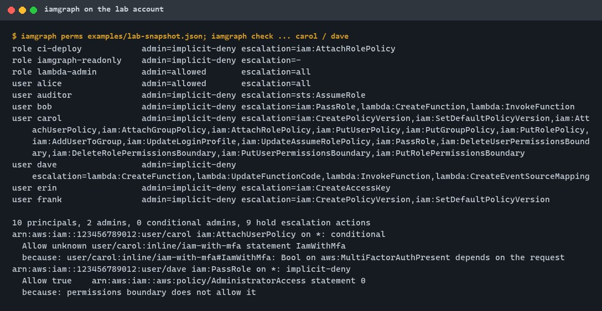
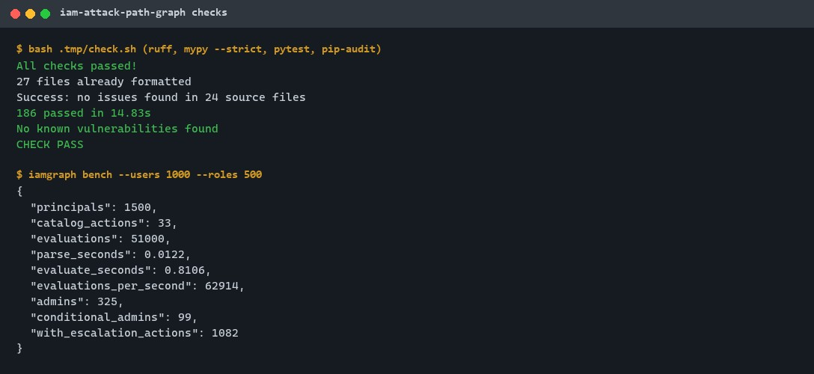
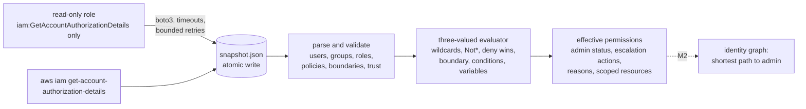
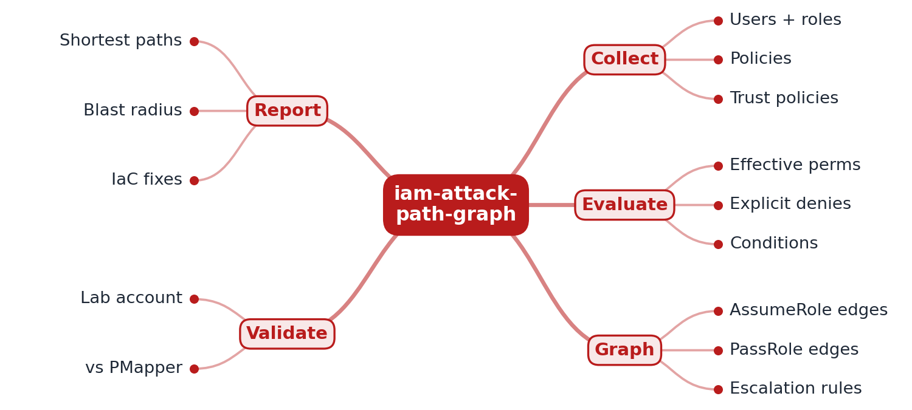

# iam-attack-path-graph

[](https://github.com/EquinoxWN/iam-attack-path-graph/actions/workflows/ci.yml)


> Reads an AWS account's IAM through a read-only role and computes every user's and role's effective permissions (wildcards, explicit denies, boundaries, conditions), the base for finding the chain that turns a low-privilege identity into an admin.

Part of my **Cyber Security** list · Python · core project

## Proof it works

`iamgraph perms` on the hand-written lab account: two admins, a user blocked by a permissions
boundary, an MFA-gated `iam:*` reported as conditional with the reason, and the PassRole plus
Lambda combination that M2 will turn into a path to admin:



189 tests pass; lint, `mypy --strict` and the dependency audit are clean; 51,000 evaluations
(1,500 principals) take 0.81 s:



## Architecture

**What M1 runs today:**



**Full roadmap (M1 to M3):**



## How it works

_Steps 1 and 2 are built and tested (M1); the rest is on the [roadmap](#roadmap)._

1. It reads users, roles, groups, policies and trust policies through a read-only role.
2. A policy evaluator computes each principal's effective permissions, handling wildcards, explicit denies and conditions.
3. Principals become graph nodes; edges are ways to gain another identity: assuming a role, passing a role to Lambda or EC2, creating access keys, editing a policy.
4. Graph search finds the shortest path from any low-privilege identity to admin, and the blast radius of every principal.
5. Each path is reported with the exact permissions that enable it and a least-privilege Terraform fix.
6. A deliberately vulnerable lab account, built and torn down with Terraform, validates results against PMapper.

Details of M1:

- **Collection** makes one read call, `GetAccountAuthorizationDetails`, after assuming a role whose
  only permission is that call ([`deploy/readonly-role/`](deploy/readonly-role/permissions-policy.json)).
  The output of `aws iam get-account-authorization-details` works as well.
- **Evaluation** answers `allowed`, `explicit-deny`, `implicit-deny` or `conditional`. Anything
  that depends on what the snapshot cannot know (MFA, source IP, region, "only some resources")
  is `conditional`, with the reason, instead of a guess ([ADR 0002](docs/adr/0002-three-valued-evaluation.md)).
- **Reports** list, for every principal, whether it is an administrator and which of 29
  privilege-escalation actions and 4 data-access actions it holds.

## Who it helps

- **Who:** cloud security engineers and platform teams responsible for an AWS account.
- **The problem:** a principal's real permissions are spread over inline policies, managed
  policies, groups, boundaries, denies and conditions, so "who can escalate?" is hard to answer
  by reading JSON.
- **How to use it:** create the read-only role, run `iamgraph collect`, then `iamgraph perms` to
  see admins and holders of escalation actions, and `iamgraph check` to ask about one request and
  see the statements that decided it. Everything after collection runs offline.

## Tech stack

| Area | In M1 | Planned |
|---|---|---|
| Core | Python 3.11+, standard library only; boto3 (optional) for live collection | networkx identity graph (M2) |
| Analysis | IAM policy evaluator: wildcards, `NotAction`/`NotResource`, explicit deny, boundaries, 26 condition operators with `IfExists`/`ForAllValues`/`ForAnyValue`/`Null`, policy variables | escalation edges, shortest path to admin, blast radius (M2) |
| Output | text and JSON reports, per-request explanation | SARIF, least-privilege Terraform fixes, comparison with PMapper (M3) |

Code in [`src/iam_attack_path_graph/`](src/iam_attack_path_graph): `collect.py` (read-only
collection), `snapshot.py` and `policy.py` (parsing), `evaluator.py`, `conditions.py`,
`wildcard.py` (evaluation), `effective.py` and `catalog.py` (reports), `trust.py`, `cli.py`.

## Run it

**Prerequisites:** Python 3.11+. `make` is optional; each target is one command shown in the
[Makefile](Makefile).

```bash
python -m venv .venv && source .venv/bin/activate   # Windows: .venv\Scripts\activate
make setup     # pip install -e ".[dev]"
make lint      # ruff, ruff format --check, mypy --strict
make test      # 189 tests
make demo      # iamgraph perms examples/lab-snapshot.json
make bench     # iamgraph bench --users 1000 --roles 500
make audit     # pip-audit
```

Query one request, optionally with what you know about the request context:

```bash
iamgraph check examples/lab-snapshot.json --principal carol --action iam:AttachUserPolicy
iamgraph check examples/lab-snapshot.json --principal carol --action iam:AttachUserPolicy \
  --context aws:MultiFactorAuthPresent=true
iamgraph perms examples/lab-snapshot.json --principal bob --json
iamgraph trust examples/lab-snapshot.json
```

### Collecting from your own account

1. Create a role with [`permissions-policy.json`](deploy/readonly-role/permissions-policy.json)
   (only `iam:GetAccountAuthorizationDetails`) and a trust policy like
   [`trust-policy.json`](deploy/readonly-role/trust-policy.json) (one named principal, an external
   ID, MFA). Replace the example account ID, user and external ID with your own.
2. With credentials for that principal in the standard boto3 chain (environment, profile or SSO):

```bash
pip install -e ".[aws]"
iamgraph collect --role-arn arn:aws:iam::<account-id>:role/iamgraph-readonly \
  --external-id <your-external-id> --out snapshots/account.json
iamgraph perms snapshots/account.json
```

The snapshot contains the account's complete IAM configuration: store it like any other security
artifact and do not commit it. The code reads no environment variables of its own; AWS credentials
and region come from boto3's usual configuration.

## Tests and results

189 tests, all passing locally (Windows 11, Python 3.14.5) and in CI (Ubuntu, Python 3.12). Full
results: [docs/results/m1.md](docs/results/m1.md). Quality check and mutation table:
[docs/quality/2026-11-01.md](docs/quality/2026-11-01.md) (13 of 13 hand mutations killed, including the two security-review fixes).

| File | Tests | What it proves |
|---|---|---|
| [`test_wildcard.py`](tests/test_wildcard.py) | 20 | `*`/`?` semantics; equal to a regex reference on 5,000 random pairs; no backtracking blow-up |
| [`test_policy.py`](tests/test_policy.py) | 26 | Accepted shapes, URL-encoded documents, 20 malformed documents rejected with the location, size limits |
| [`test_conditions.py`](tests/test_conditions.py) | 48 | Every supported operator family, negation, absent versus unknown keys, `IfExists`, set operators, `Null`, variables |
| [`test_evaluator.py`](tests/test_evaluator.py) | 22 | Deny precedence, `Not*`, boundaries, variables, "every action/resource" queries (a `NotAction` allow makes a conditional admin), 300 randomized policies |
| [`test_snapshot.py`](tests/test_snapshot.py) | 16 | Parsing the API format, default policy versions, group inheritance, warnings, malformed snapshots |
| [`test_effective.py`](tests/test_effective.py) | 24 | Expected answers for every lab principal; the read-only role grants no write |
| [`test_trust.py`](tests/test_trust.py) | 6 | Who each trust policy lets in, including `NotPrincipal` allows (wildcard trust) and account roots in every partition |
| [`test_collect.py`](tests/test_collect.py) | 16 | Role assumption, timeouts, bounded retries, pagination limits, error chaining, atomic writes (fake boto3) |
| [`test_cli.py`](tests/test_cli.py) | 11 | Every command, exit code 2 on errors, no write on an invalid collection |

| Result | Value |
|---|---|
| Lab account | 10 principals, 2 admins, 9 hold escalation actions; boundary, MFA condition, deny, `${aws:username}` and URL-encoded policy all handled as expected |
| Evaluation speed | 51,000 evaluations (1,500 principals x 34 queries) in 0.81 s, 62,914 per second |
| Read-only role | grants `iam:GetAccountAuthorizationDetails` and no catalog or write action (checked by the evaluator itself) |
| Lint, types, audit | ruff clean, `mypy --strict` clean, pip-audit: no known vulnerabilities |

Not verified yet: live collection against a real AWS account (the boto3 path is tested with a fake
client), and agreement with AWS's policy simulator and PMapper (M3).

## Roadmap

**M1** (done)
- [x] Write `docs/rfc/0001-design.md`: problem, goals, non-goals, chosen design
- [x] It reads users, roles, groups, policies and trust policies through a read-only role.
- [x] A policy evaluator computes each principal's effective permissions, handling wildcards, explicit denies and conditions.

**M2** (≈20 h)
- [ ] Principals become graph nodes; edges are ways to gain another identity: assuming a role, passing a role to Lambda or EC2, creating access keys, editing a policy.
- [ ] Graph search finds the shortest path from any low-privilege identity to admin, and the blast radius of every principal.

**M3** (≈25 h)
- [ ] Each path is reported with the exact permissions that enable it and a least-privilege Terraform fix.
- [ ] A deliberately vulnerable lab account, built and torn down with Terraform, validates results against PMapper.
- [ ] Publish the proof below with real numbers

## Proof

What this repo must show before it counts as done (M3):

- An attack-path diagram from a read-only user to admin in the lab account, and the one-line fix that breaks it.

| Result | Value |
|---|---|
| Effective permissions, lab account (M1) | 2 admins and 9 holders of escalation actions found, as expected |
| Evaluation throughput (M1) | 62,914 evaluations per second on 1,500 principals |
| Attack path to admin (M3) | not built yet |

## Why it matters

- **Interview angle:** 'How would an attacker escalate privileges in our AWS?'
- **Upstream I'm contributing to:** PMapper or Cloudsplaining.

## Design docs

- [RFC 0001: design](docs/rfc/0001-design.md)
- [ADR 0001: record architecture decisions](docs/adr/0001-record-architecture-decisions.md)
- [ADR 0002: three-valued evaluation instead of guessing](docs/adr/0002-three-valued-evaluation.md)
- [ADR 0003: one read-only call, offline analysis](docs/adr/0003-offline-snapshot-from-one-read-call.md)
- [M1 results](docs/results/m1.md)

## Scope

A learning and portfolio project, not a hosted service. It only reads IAM metadata and reasons
about it offline; it never calls a write API or runs an attack. M1 covers identity-based policies
and permissions boundaries in one account; service control policies, session policies and
resource-based policies are out of scope for now. The lab account is a JSON file with invented
names and AWS's documentation account ID.

## Security and contributing

See [SECURITY.md](SECURITY.md) for reporting a vulnerability and [CONTRIBUTING.md](CONTRIBUTING.md)
for the development workflow.

## License

MIT, see [LICENSE](LICENSE).
